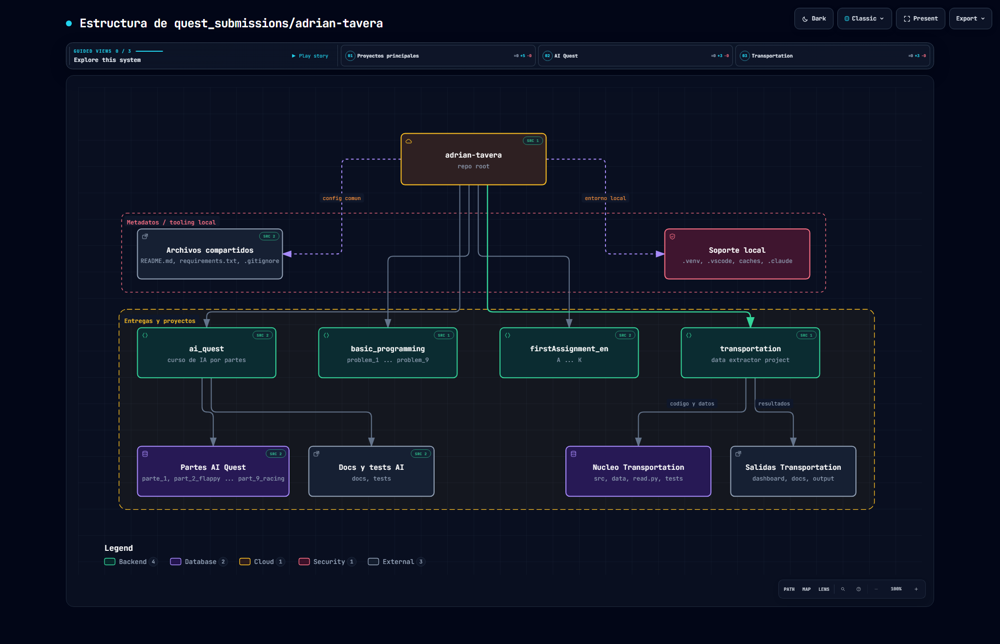
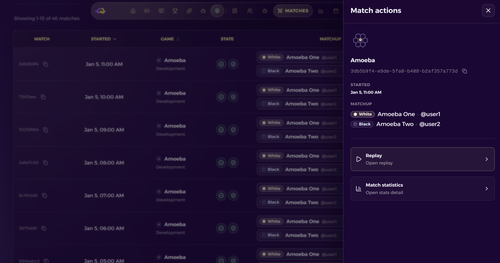
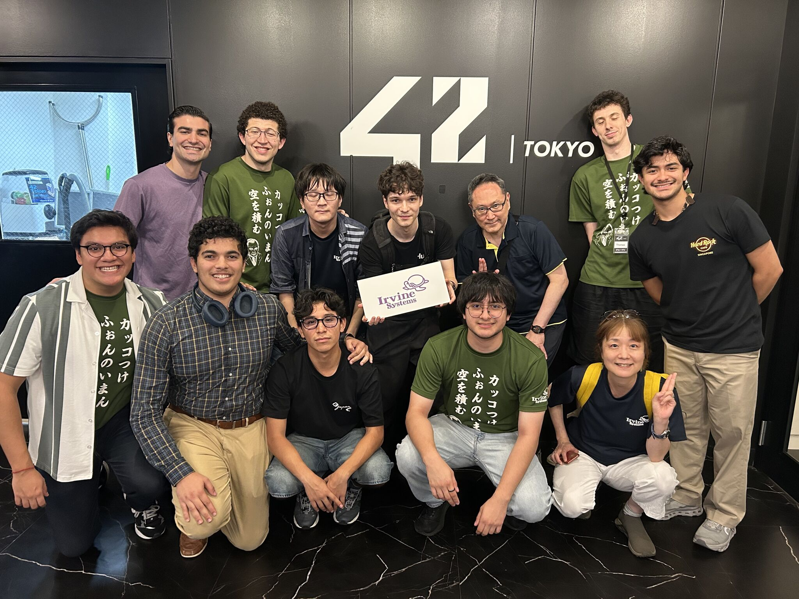
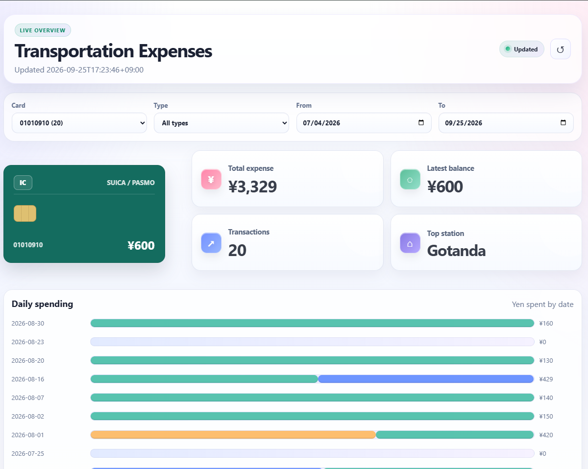
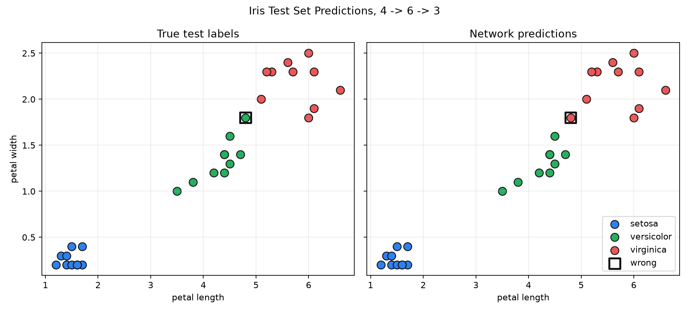
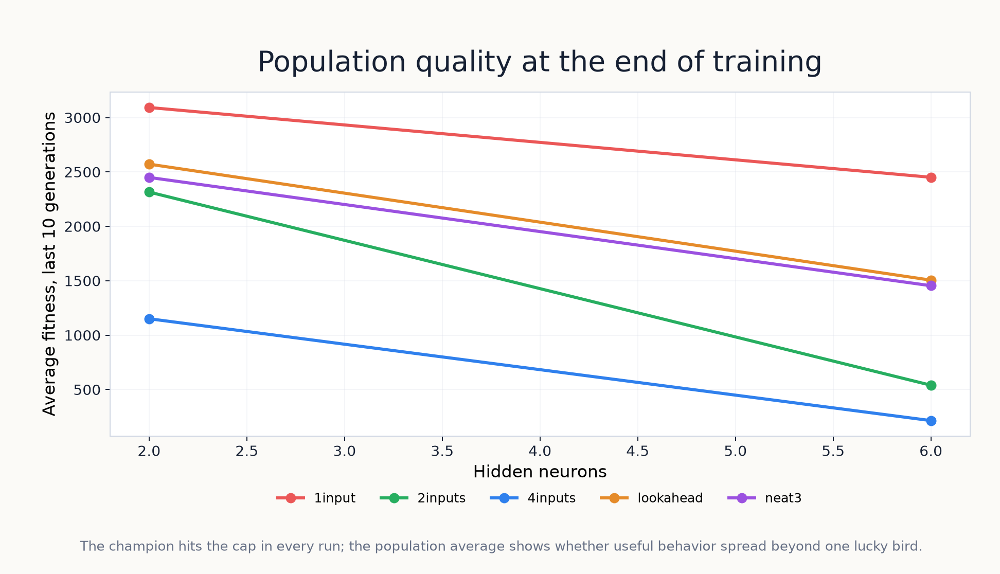
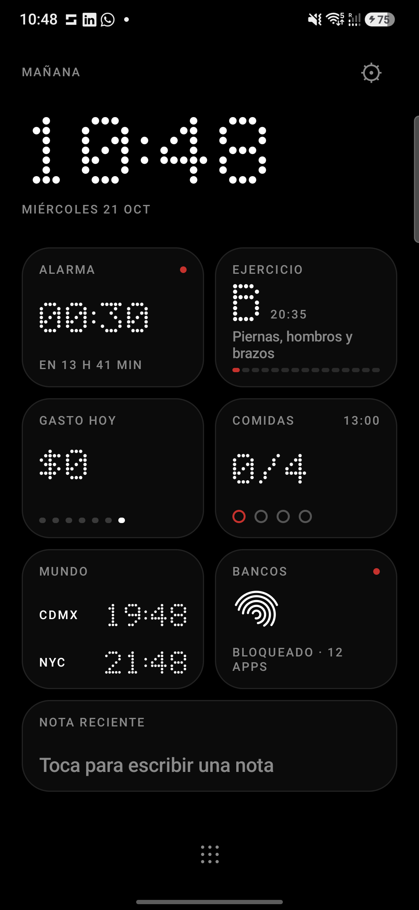
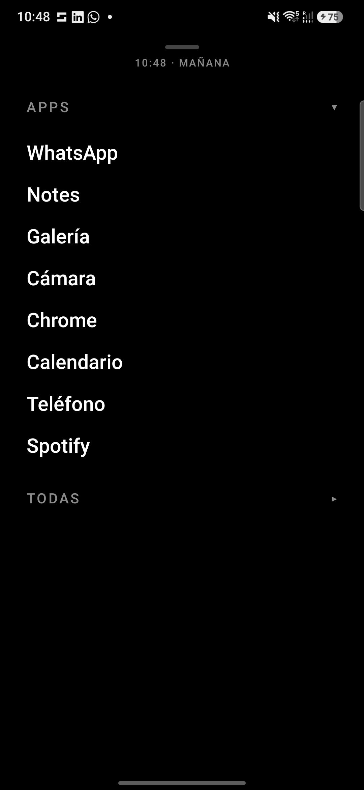
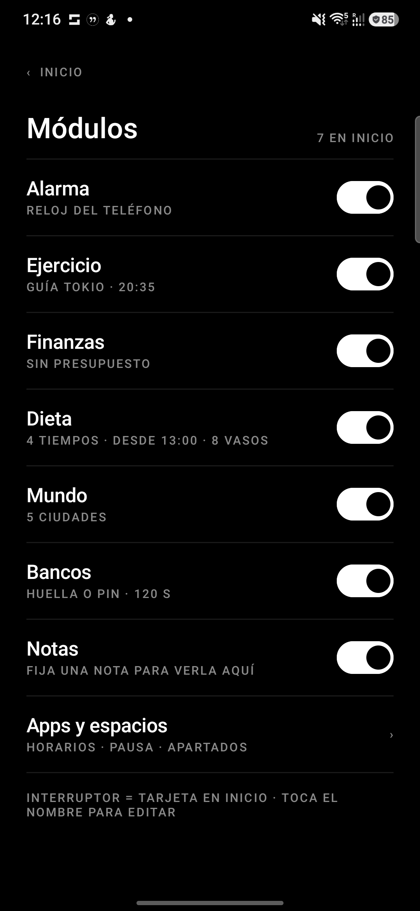
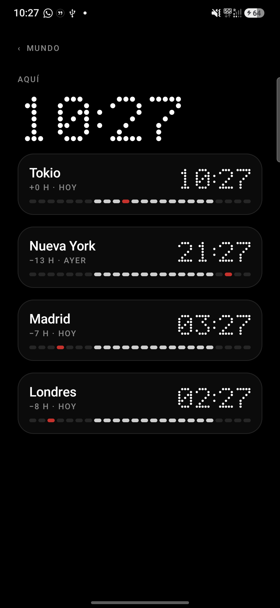

<div align="center">

# 創る、そして学ぶ · Create & Learn
### **Adrián Tavera Aquino** — Software & AI Engineering Internship · Irvine Systems (Tokyo, 2026)

[](https://abrilolo.github.io/tokyo-internship-2026/)

*An interactive WebGL & Three.js presentation showcasing five engineering projects built during my internship in Tokyo, plus a visual memory wall of life in Japan.*

</div>

---

## Preview · What's Inside

The presentation unfolds as a scroll-driven experience across five Washi-paper chapters (`基` · `共` · `旅` · `知` · `静`), followed by sliding fusuma doors that open onto Mount Fuji and a drifting wall of 175 photographs from Japan.

<p align="center">
  <a href="https://abrilolo.github.io/tokyo-internship-2026/">
    
  </a>
</p>

---

### 01 · `基` Programming Fundamentals *(Foundation)*
20 exercises covering data structures (linked lists, stacks, queues, self-balancing trees, hash tables with collision avoidance), C performance optimization, a Linux watchdog, cryptanalysis, and **IrvineLang** (a bit-tape virtual machine interpreter).

<p align="center">
  
</p>

---

### 02 · `共` Game Arena *(Building Together)*
Frontend engineering on a shared team codebase (Angular, Docker, GitLab CI): replacing row action buttons with a unified side-panel menu, building temporary bot-vs-bot practice rooms, passing all 40 pipeline tests, and seeing developers test their bots live at **42 Tokyo**.

| Admin Side Panel & Match Actions | Live Testing at 42 Tokyo |
| :---: | :---: |
|  |  |

---

### 03 · `旅` Suica · From Tap to Insight *(Transit)*
Reading raw 16-byte FeliCa blocks from a physical Suica card via a Sony USB NFC reader (`nfcpy`), mapping hex station codes to Japanese and English (`ekicode.csv` + `pykakasi`), preserving travel history beyond the card's 20-trip limit, and exporting to Excel and an interactive web dashboard.

<p align="center">
  
</p>

---

### 04 · `知` AI Quest *(Learning in Action)*
From a single neuron and backpropagation in pure Python (96.67% on Iris) to evolving game agents in **Flappy Bird** and **autonomous racing (NEAT)**, a **15,742-parameter causal self-attention Transformer** trained from scratch, and a local tool-using AI agent.

| Neural Networks (Iris Classification) | Flappy Bird Neuroevolution Experiments |
| :---: | :---: |
|  |  |

---

### 05 · `静` Minimal Launcher *(Designed for Focus)*
A minimalist black-and-white Android home screen built for daily use on a Galaxy S24+ with **Kotlin** and **Jetpack Compose**, featuring context-aware app sets (*Morning · Work · Night*) and built-in modules for workouts, diet, notes, and world clocks (Mexico ↔ Tokyo).

<p align="center">
  
  
  
  
</p>

---

## Running Locally

No build step or package installation is required. Serve the repository root with any static HTTP server:

```powershell
python -m http.server 8766 --bind 127.0.0.1
```

Then open [`http://127.0.0.1:8766/presentation/`](http://127.0.0.1:8766/presentation/).
