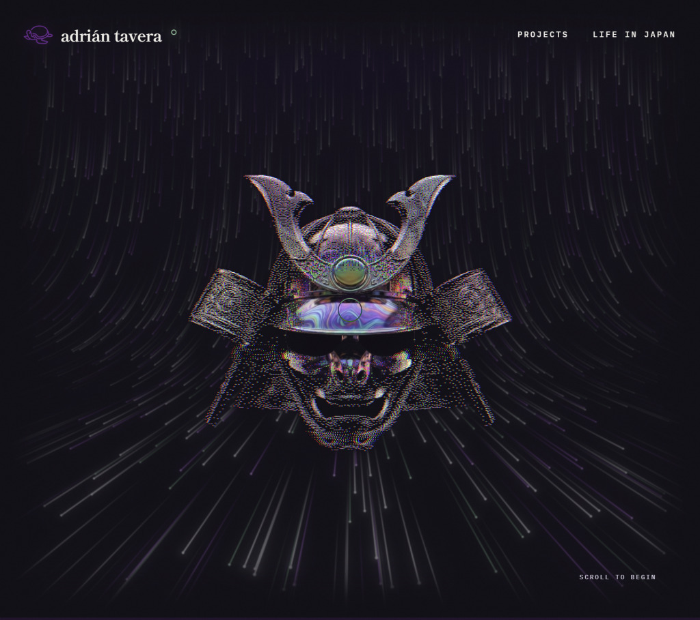
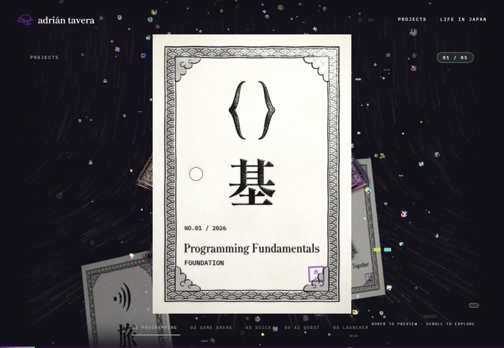
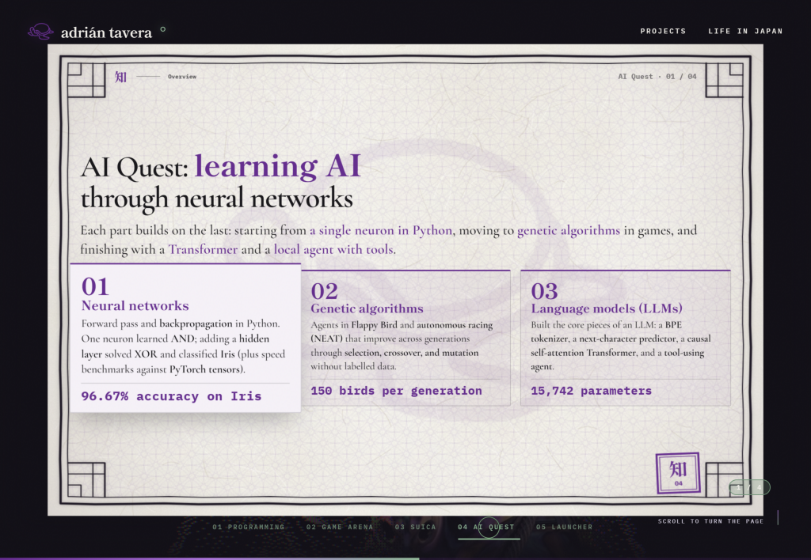
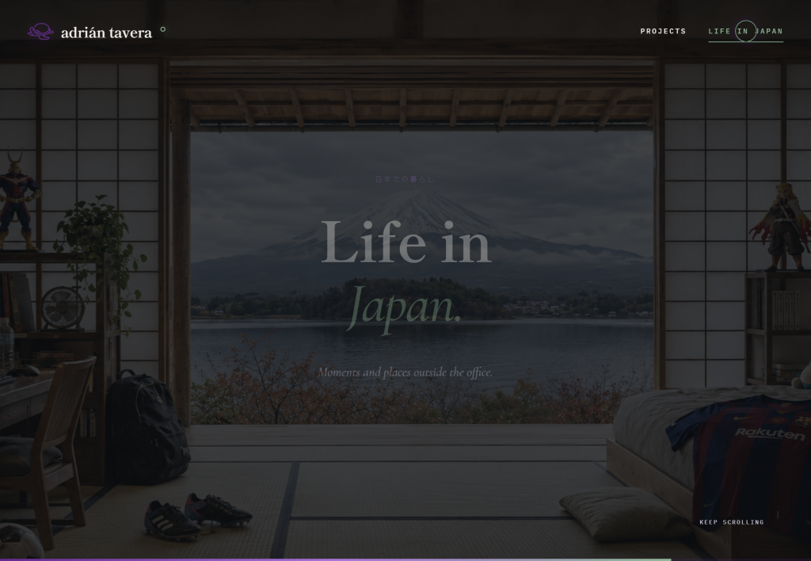
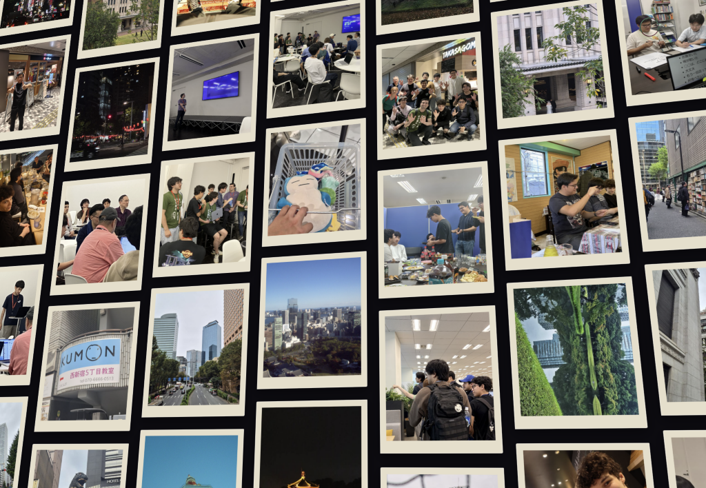

# 創る、そして学ぶ · Create & Learn
### **Adrián Tavera Aquino** — Tokyo Internship 2026 · Irvine Systems

*Interactive WebGL & Three.js final presentation showcasing the five projects I built during my internship at Irvine Systems in Tokyo, along with memories from life in Japan.*

---

## Presentation Preview

  

| 3D Washi Cards & Helix Navigation | Unfolded Washi Chapter View |
| :---: | :---: |
|  |  |

| Japanese Room Overlooking Mount Fuji | Drifting Wall of Japan Photographs |
| :---: | :---: |
|  |  |

---

## Chapters Inside

1. **`基` Programming Fundamentals** — Data structures, C optimization, cryptanalysis, and *IrvineLang*.
2. **`共` Game Arena** — Shared Angular frontend features, temporary bot-vs-bot practice rooms, and live testing at *42 Tokyo*.
3. **`旅` Suica · From Tap to Insight** — Reading raw FeliCa NFC bytes in Python, station translation (`ekicode.csv` + `pykakasi`), and an interactive expense dashboard.
4. **`知` AI Quest** — Neural networks from scratch, neuroevolution in *Flappy Bird* and *Autonomous Racing (NEAT)*, a *15,742-parameter Transformer*, and a local tool-using agent.
5. **`静` Minimal Launcher** — Custom black-and-white Android home screen built in Kotlin & Jetpack Compose.
6. **`日本での暮らし` Life in Japan** — Sliding fusuma doors opening onto Mount Fuji and a 3D drifting wall of 175 photographs.
